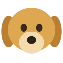

# AnimalDesk 🐕🐈 — il tuo animale sul desktop

Il tuo cane (o gatto) che vive **sopra** le tue finestre, piccolo, sempre visibile
e sempre impegnato a fare qualcosa. Parte dalle sue **foto vere**: una figura
intera seduta, la faccia seria, una foto di spalle, un primo piano. Codice
originale, nessun asset di terze parti.



## Tre aspetti, stesso cervello

| Aspetto | Come | Dove |
|---|---|---|
| **Foto reale** (default) | la foto vera dell'animale, ritagliata a livello del singolo pelo e animata con un **rig a mesh**: la testa gira con parallasse (il naso si sposta piu' del cranio), si inclina attorno al collo, le orecchie seguono con una molla, le palpebre sono pelo vero che scende sull'occhio | `skin.py`, `assets/skins/<nome>/` |
| **Disegno: golden retriever** | vettoriale con gradienti, pelo e occhio con iride | `dogart.py` |
| **Disegno: barboncino** | stesso scheletro, manto riccio, ciuffo e coda a pompon | `breeds.py` |

### Piu' foto, piu' viste

Una pelle e' fatta di **viste**, una per foto. Ogni azione chiede la vista che le
serve e il passaggio dall'una all'altra e' un **morph** (come in PowerPoint): testa,
occhi, naso, zampe e sagoma di una foto scivolano sulle parti corrispondenti
dell'altra, e i colori si fondono solo a cose gia' allineate. Non e' una dissolvenza.

| Vista | Foto | A cosa serve |
|---|---|---|
| `seduto` | figura intera di fronte, espressione allegra | la posa di tutti i giorni e tutte le azioni, **zampe comprese** |
| `serio` | figura intera di fronte, faccia seria | **Non ho voglia**, **Fai la cacca** |
| `dietro` | figura intera di spalle | **Me ne vado** e ogni spostamento (con il passo) |
| `busto` | primo piano di testa e petto | solo con l'inquadratura *Primo piano* (o per animali senza zampe rilevate) |

### Zampe a figura intera

Ogni vista a figura intera ha nel rig le sue `legs`: attacco, piede e larghezza di
ciascuna zampa. La mesh le muove da sola: il piede sale (la gamba si accorcia
dall'attacco in giu') e gira verso il petto o in fuori, mentre petto e corpo
restano fermi. Cosi' ogni azione usa le zampe anche a figura intera: la tastiera
si batte a zampe alternate (con la tastiera davanti), la leccata porta la zampa
al muso, la grattata gratta il collo, "nanana" le alza una dopo l'altra, abbaiare
fa sobbalzare, presa in mano penzola, ogni tanto sposta il peso a riposo, e di
spalle fa il passo. Il nascondino lo fa scendere sotto il bordo.
Per le pelle create dall'app le zampe si trovano dalla sagoma (i due piedi piu'
esterni); se non ne trova, le azioni ripiegano sul primo piano.

Menu **Inquadratura**: *Figura intera* (seduto sul bordo dello schermo) oppure
*Primo piano* (affacciato dal bordo, come nella versione 1.1). Se una vista manca
l'azione ripiega sulla piu' vicina: con una sola foto funziona comunque tutto.

La figura intera **non cammina**: non esiste una foto di lui che cammina di lato,
e far scivolare una foto ferma sembrerebbe finto. Quando deve spostarsi (palla,
biscotto, puntatore) si gira, se ne va di spalle rimpicciolendo e ricompare nel
punto nuovo.

### Azioni

Seduto, dormi, **scrivi alla tastiera**, **nascondino**, lecca la zampa, guardati
intorno, **testa di lato**, grattata, occhi felici, linguetta, dispetto, abbaia, e:

- **Non ho voglia** — la foto seria: palpebre a mezz'asta, si volta piano
  dall'altra parte, sospira. Quando e' molto stanco a volte risponde cosi' anche
  a un altro comando.
- **Me ne vado** — ti guarda, si gira, se ne va di spalle. Dopo qualche secondo
  torna, da un'altra parte.
- **Fai la cacca** — ti fissa serissimo, si accuccia appena, lascia il ricordino,
  due zampate di terra e (spesso) si allontana fischiettando.
- **Sdraiati** — (se c'e' la foto `sdraiato`) si sdraia con un morph, si guarda
  intorno, sorride con la lingua, ogni tanto allunga una zampa.
- **Dormi** usa la foto `dorme` se c'e': si accoccola davvero, con il respiro.

### Pelli incluse

| Pelle | Viste | Note |
|---|---|---|
| `golden-reale` | seduto, serio, di spalle, primo piano | il golden |
| `olaf` | seduto (in smoking), sdraiato, dorme | barboncino. Testa di tre quarti: un occhio e' nascosto dal muso (`"hidden": true`, niente palpebra). Senza foto di spalle, per andarsene e spostarsi scende sotto il bordo e risale altrove. La medaglietta e' ridipinta: niente numeri di telefono negli sprite |

Si sceglie da **Aspetto → Foto: ...**.

Lo sguardo segue il puntatore quando e' vicino, e la palla mentre rimbalza. Gli
spostamenti del viso sono limitati di proposito e misurati in "teste", cosi'
valgono uguali per un primo piano e per una figura intera (un test verifica che
nessun vertice si muova piu' del 12,5% dell'altezza della testa e che zampe e
petto restino fermi): il muso non si deforma mai.

### Oggetti a terra

Palla, biscotti, ciotola e ricordini **spariscono da soli dopo qualche minuto**
(dissolvenza negli ultimi secondi). Menu **Gli oggetti spariscono dopo**: 1, 3
(default), 5, 10 minuti o mai. Click su un ricordino per raccoglierlo, click
sulla palla ferma per un calcetto, **Pulisci tutto** dal menu.

### Costumi

Cappello di Babbo Natale, occhiali da sole + salvagente, maschera e berretto da
sci con gli sci. Seguono la testa quando gira o si inclina. Menu **Costume**:
*Automatico* sceglie per data (1 dic - 6 gen Natale, 15 giu - 7 set mare), oppure
si forza quello che si vuole.

### Il tuo animale, in automatico (cani e gatti)

Menu **Aspetto -> Nuovo animale da foto...** (si possono scegliere piu' foto
insieme) oppure:

```bash
pip install -e ".[foto]"
export ANTHROPIC_API_KEY=...        # facoltativa, vedi sotto
python -m animaldesk.tools.auto_skin seduto.jpg serio.jpg spalle.jpg muso.jpg --nome fido
```

Per ogni foto:

1. un modello di visione (Claude) la guarda e restituisce, come JSON validato da
   schema: **specie** (cane, gatto), **inquadratura** (primo piano, figura intera
   di fronte, di spalle), **espressione**, bocca aperta o chiusa, i riquadri di
   testa+petto e dell'animale intero, i punti del viso;
2. lo sfondo viene tolto (GrabCut guidato da quei punti + alpha matting);
3. i punti vengono rifiniti sui pixel (centro reale di occhi e naso);
4. la foto diventa la vista giusta (`busto`, `seduto`, `serio`, `dietro`).

Da una figura intera di fronte si ricava da solo anche il primo piano, quindi
**una sola foto a figura intera basta** per avere tutte le azioni; le altre foto
le rendono piu' belle. Tutto e' guidato dal rig: non c'e' niente da ridisegnare.
Se il modello giudica una foto inadatta (muso girato, occhio coperto, testa
tagliata) lo dice e si va avanti con le altre.

Per un gatto cambia solo il verso (*Miagola*, "Miao!") e qualche fumetto: orecchie
dritte o pendenti sono gestite dagli stessi punti base/punta.

Senza chiave API si usa una stima dai pixel (le tre macchie scure del muso; la
distanza tra gli occhi dice se e' un primo piano o una figura intera): funziona
su animali chiari con occhi e naso ben visibili, non riconosce le foto di spalle,
e in ogni caso la finestra mostra i punti di ogni vista e li lascia trascinare.

Foto che rendono meglio: animale intero nell'inquadratura, zampe comprese, muso
di fronte, occhi entrambi visibili, **sfondo che stacca dal pelo e niente
guinzaglio** (il ritaglio automatico non li toglie: nella pelle di esempio
guinzaglio e pupazzo sono stati tolti a mano).

## Cosa fa il cane

| Comportamento | Cosa vedi |
|---|---|
| `idle` | respira, sbatte le palpebre, scodinzola |
| `walk` / `run` | cammina e corre sul bordo inferiore dello schermo, lingua fuori quando corre |
| `sit` | si siede |
| `sleep` | si sdraia e fa `z z z` (recupera energia) |
| `bark` | abbaia con fumetto ("Woof!", "Bau!") |
| `dig` | scava e lancia terra |
| `scratch` | si gratta l'orecchio |
| `spin` | si rincorre la coda |
| `roll` | capriola completa |
| `jump` | salto con gravità reale |
| `chase` | insegue il puntatore del mouse |
| `fetch` | rincorre la palla, la prende in bocca e te la riporta |
| `eat` | va alla ciotola e mangia (riduce la fame) |
| `dragged` / `fall` | lo prendi in mano, zampe che si agitano, poi cade e atterra |
| `pet` | coccola: occhi socchiusi, guance rosse, cuoricini |

Il cane ha tre statistiche (**energia**, **fame**, **felicità**) che cambiano nel
tempo e pesano sulla scelta del prossimo comportamento: stanco → dorme, affamato
→ va alla ciotola, felice → fa più capriole. Le statistiche vengono salvate e
ritrovate al riavvio.

## Come si usa

| Gesto | Effetto |
|---|---|
| Trascinamento col tasto sinistro | lo sposti lungo il bordo (il disegno vettoriale si solleva e cade) |
| Click su un ricordino / sulla palla ferma | lo raccogli / le dai un calcetto |
| Doppio click | carezza (cuoricini) |
| Tasto destro | menu completo |
| Rotellina sopra il cane | cambia la taglia |
| Icona nella tray | stesso menu + statistiche |

Dal menu: le azioni, **lancia la palla**, **dai un biscotto**, **dai da
mangiare**, *pulisci tutto*, *insegui il mouse*, aspetto, inquadratura, costume,
taglia (mini/piccolo/medio/grande), vivacità, durata degli oggetti a terra,
scelta dello schermo su setup multi-monitor, **avvio automatico al login**, esci.

## Avvio

```bash
pip install PySide6-Essentials
python -m animaldesk
```

Su Linux serve un desktop con supporto alle finestre trasparenti e alla tray
(X11 o Wayland con XWayland).

## Build eseguibile

```bash
pip install -e ".[build]"
python packaging/make_icon.py          # rigenera le icone dal vettoriale
pyinstaller packaging/animaldesk.spec     # -> dist/AnimalDesk(.exe) / AnimalDesk.app
```

Su macOS il bundle è marcato `LSUIElement`, quindi niente icona nel Dock: solo
la tray e il cane.

## Com'è fatto

```
animaldesk/
├── skin.py      pelle fotografica: rig a mesh sulla foto vera, piu' viste (SkinSet)
├── dogart.py    disegno vettoriale realistico, parametrico per razza
├── breeds.py    razze (golden, barboncino)
├── render.py    palla, ciotola, particelle, fumetti, icona
├── outfits.py   costumi stagionali e oggetti di scena (tastiera, salvagente, sci)
├── tools/auto_skin.py  da foto a pelle in automatico (visione AI + ritaglio + rig)
├── ui_skin.py   finestra "Nuovo animale da foto": punti correggibili per ogni vista
├── pet.py       macchina a stati + fisica + statistiche (nessuna dipendenza Qt)
├── props.py     palla, ciotola, biscotti, ricordini a tempo, particelle (nessuna dipendenza Qt)
├── overlay.py   finestra trasparente a tutto schermo, maschera click-through
├── app.py       tray, menu, impostazioni
├── config.py    configurazione JSON nella cartella utente
└── autostart.py avvio al login su Windows / macOS / Linux
```

La finestra è un overlay a tutto schermo, frameless, `WindowStaysOnTopHint` e
`WA_TranslucentBackground`. Ad ogni frame viene ricalcolata una **maschera**
(`setMask`) che copre solo cane, palla, ciotola, fumetto e particelle: tutto il
resto dello schermo resta cliccabile normalmente, quindi l'overlay non ruba mai
i click al desktop.

`pet.py` e `props.py` non importano Qt: sono matematica pura e si testano senza
display.

```bash
python -m pytest -q      # 150 test
```

## Licenza

MIT. Grafica e logica scritte da zero per questo progetto.
